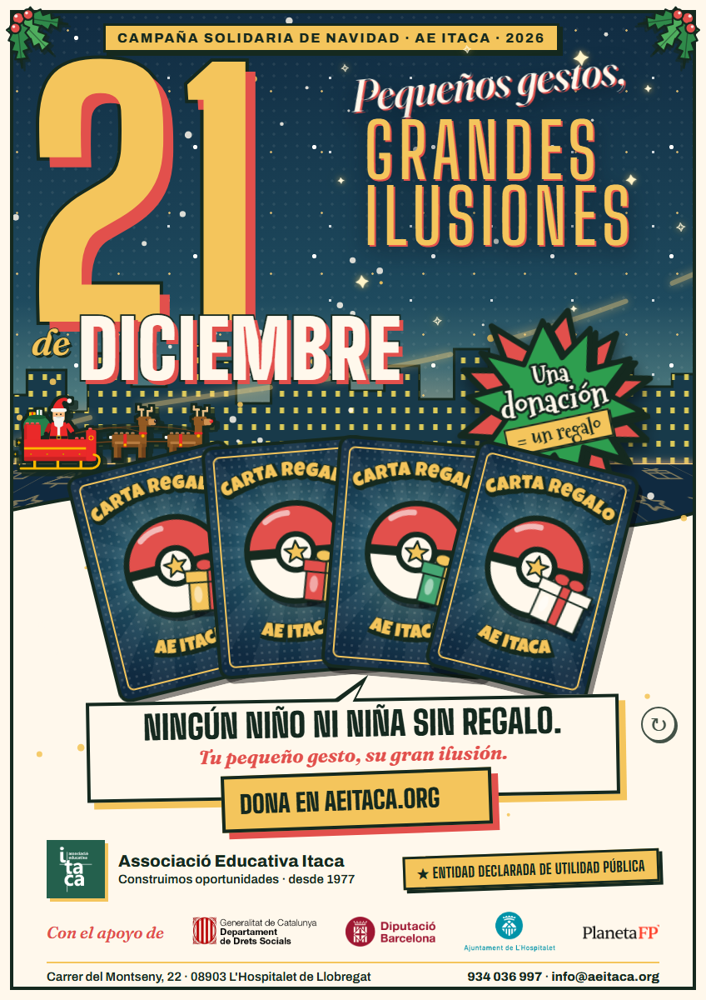
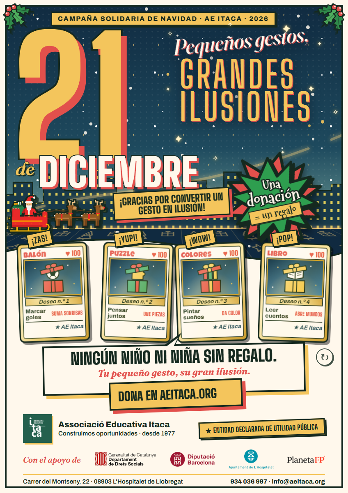

# ¡Pequeños gestos, grandes ilusiones!

Cartel digital interactivo (estilo *The Moving Poster*) para la **campaña solidaria de Navidad de la Associació Educativa Itaca (AE Itaca)**, de L'Hospitalet de Llobregat: recaudar donaciones para comprar regalos de Navidad a niños y niñas en riesgo de exclusión social. Fecha clave: **21 de diciembre de 2026**.

| Estado inicial | Estado final (todas las cartas giradas) |
|---|---|
|  |  |

## Concepto

Ítaca es una pequeña isla, y AE Itaca defiende que **las pequeñas acciones producen grandes cambios** ("Construimos oportunidades"). En el cartel, cada donación es un pequeño gesto que se convierte en un regalo y en una ilusión.

El mensaje es **humilde y directo**: no hace falta mucho, **una donación = un regalo**. No se fija ninguna cantidad: cada uno aporta la voluntad.

### Dirección de arte: una Navidad de cómic con tres referencias

| Referencia | Qué se ha tomado |
|---|---|
| **Pop-art** (*Pop-Art Factory*) | Contornos marcados, sombras duras, pegatinas giradas, abanico de cartas que se separan |
| **Cartas coleccionables** (guiño a Pokémon) | Carta con dorso azul de trama pop art y emblema central, frente que gira en 3D, balanceo en reposo, texto curvo con `textPath`, "puntos de vida", ataque, lema y brillo holográfico |
| **Cómic** | Marco de viñeta, recuadro de narración en la cabecera, bocadillo con el pico apuntando a las cartas, onomatopeyas ("¡Ho, ho, ho!", "¡POP!") y una pegatina de explosión de cómic doble |
| **Guiño vaporwave (sobrio)** | Anochecer con resplandor de atardecer, el barrio con ventanas encendidas, suelo en perspectiva con estrellitas, abetos, copos y regalos dorados muy tenues y una estela de luz suave |

**El protagonista animado: Santa en su trineo** (`assets/img/santa-trineo.svg`), hecho con piezas de construcción.
- **Animaciones propias:** el SVG trae el galope de los renos, el cabeceo, el trineo flotando, la nariz que brilla y los destellos.
- **Filtro cómic:** encima se le aplica un filtro SVG propio (`#filtro-comic`) que le dibuja un contorno oscuro, y una sombra dura.
- **En reposo:** espera a la izquierda.
- **En vuelo:** al entrar con el ratón en el cartel, despega, hace un arco por detrás de los textos, sale por la derecha y vuelve a entrar por la izquierda hasta su sitio. Lo gestiona JS con `element.animate()` sobre una ruta `offset-path`. Al despegar aparece un "¡Ho, ho, ho!".
- **Se ríe:** al pasar el ratón por encima de Santa (o al hacer clic) suena su risa "Ho, ho, ho".

**Primer plano:** colinas nevadas con contorno de cómic y un **marco de acebo**: dos ramitas en las esquinas superiores cuyas hojas se mecen cada una a su ritmo y cuyas bayas laten como lucecitas. La nieve cae y sopla hacia el ratón.

**Zona hero:** el "21" gigante y limpio con "de DICIEMBRE" justo debajo. A la derecha, el título de la campaña compuesto como el **título de una película**: *Pequeños gestos,* pequeño, en itálica e inclinado, como la frase que acompaña al título; y **GRANDES ILUSIONES** grande, recto y en mayúsculas espaciadas. La forma dice lo mismo que el texto: el gesto es pequeño y la ilusión, grande.

**Las cartas como metáfora:** cada carta es una "Carta regalo" boca abajo. Al girarla se abre el regalo y aparece el deseo de un niño o niña, con un lema que anima a donar: *Abre mundos* (libro), *Suma sonrisas* (balón), *Da color* (colores) y *Une piezas* (puzzle).

## Cómo ejecutarlo

No hace falta instalar nada ni compilar:

- **Opción 1:** hacer doble clic en `index.html`.
- **Opción 2:** en VS Code, abrir la carpeta, hacer clic derecho en `index.html` y elegir **Open with Live Server**.

Cómo usarlo:

- Mueve el ratón por el cartel. Al pasar por una carta, se da la vuelta. Mueve el ratón encima de la carta girada para inclinarla.
- Al entrar con el ratón en el cartel, **Santa despega** y da una vuelta. Si pasas el ratón por encima de Santa, **se ríe** (con sonido).
- Mientras el ratón está sobre el **cielo**, van apareciendo tandas de 2 o 3 **estrellas fugaces** en sitios al azar.
- La **pegatina "Una donación = un regalo"** (explosión de cómic doble) flota suavemente sobre el cartel, con una sombra que se aleja y se difumina.
- Al cargar la página, el **título se enciende** poco a poco (*ease-in*) con un halo dorado y después se queda "respirando" con un brillo muy suave. Una orla de estrellitas ✦ ✧ aparece una a una a su alrededor y luego titilan a ritmos distintos.
- Al entrar con el ratón en el cartel, un **destello cruza el título** de lado a lado (una franja de luz sobre el crema y el oro).
- **Sobre el sonido:** los navegadores no dejan reproducir audio hasta que el usuario ha hecho clic o pulsado una tecla en la página. La primera vez, haz clic en cualquier sitio (o en Santa) y a partir de ahí sonará al pasar el ratón.
- Pulsa la tecla **F** para activar o desactivar el **estado final** (para la captura). Este estado también se activa solo cuando ya has girado las cuatro cartas.
- El botón discreto **↻** (junto a la última carta) reinicia el cartel en cualquier momento: cierra las cartas, sale del estado final y las **baraja en un orden aleatorio**. Las cartas también se barajan al cargar la página y al salir del estado final con F.

## Estructura

```
/index.html      → estructura del cartel (lienzo de 848 × 1200 px)
/style.css       → estilos, variables y transiciones (sin :hover)
/main.js         → interacciones (JS vanilla, organizado en 5 secciones)
/README.md
/assets/img/     → logos (AE Itaca, colaboradores y Planeta FP), el SVG de Santa en su trineo y las capturas del cartel
```

## Cambios estéticos (última revisión)

| Sección | Cambio |
|---|---|
| **Mensaje** | Se elimina la cifra de 10 €. La pegatina dice **"Una donación = un regalo"** y cada carta lleva un lema motivador en lugar del precio. |
| **Título del hero** | Composición de cartel de cine: *Pequeños gestos,* en Fraunces itálica, pequeño e inclinado (−6°); **GRANDES ILUSIONES** en Big Shoulders, grande, recto y con mayúsculas espaciadas, sin punto final. Sombra roja fina en lugar del relieve triple. |
| **Título: brillo** | Encendido al cargar (*ease-in*: de oscuro y desenfocado a un destello dorado) y después un halo que "respira". Orla de 7 estrellitas ✦ ✧ que se encienden una a una y titilan. Todo en CSS (`@keyframes` sobre `filter` y `opacity`). |
| **Pegatina** | Más grande (212 px). "Una donación" con la misma tipografía navideña que "= un regalo" (Mountains of Christmas). |
| **Dorso de las cartas** | Del verde al **azul del cielo del hero**, con la misma trama de puntitos pop art, un resplandor central con rayos suaves y un **emblema** propio (esfera roja y crema con franja y estrella dorada), guiño a las cartas de Pokémon. El regalo queda delante del emblema. |
| **Frente de las cartas** | La ventana de la ilustración y el pie "★ AE Itaca" pasan del verde al azul noche. "Puzle" pasa a **"Puzzle"**. Lemas: *Abre mundos*, *Suma sonrisas*, *Da color*, *Une piezas*. |
| **Footer** | Más margen respecto al marco del cartel. Las tres filas (Itaca + sello, apoyos, contacto) van alineadas de borde a borde con `space-between`. "Con el apoyo de" en Fraunces itálica roja. Logos ordenados de lo general a lo local (Generalitat → Diputació → Ajuntament → Planeta FP) con alturas compensadas. Filete dorado sobre el contacto. |

## Efectos JavaScript por sección del cartel

| Sección | Efecto | Técnica JS | Función |
|---|---|---|---|
| **Todo el cartel** | Se escala para caber en la ventana | `resize` → variable `--escala` (`transform: scale()`) | `escalarCartel()` |
| **Todo el cartel** | Parallax por capas: estrellas, ciudad, rejilla, colina, pegatina y cartas se mueven a distintas profundidades | `mousemove` + `data-depth` → `--px` / `--py`, suavizado con *lerp* en `requestAnimationFrame` | `moverParallax()`, `animar()`, `reposarParallax()` |
| **Cielo** | Tandas de 2 o 3 estrellas fugaces mientras el ratón está en el cielo | Elementos creados con `createElement` y animados con `element.animate()` (`transform`, `opacity`); `setTimeout` para la siguiente tanda | `comprobarCielo()`, `lanzarEstrellasFugaces()`, `crearEstrellaFugaz()` |
| **Cielo** | Nieve que cae y sopla hacia el ratón (algunos copos dorados) | `<canvas>` 2D dibujado en un bucle de `requestAnimationFrame` | `crearCopos()`, `dibujarNieve()`, `animarNieve()` |
| **Fecha "21"** | La sombra dura se alarga al lado contrario del ratón y el grosor de la letra cambia con la X | `fontVariationSettings` (eje `wght`) y `--sombra-x` / `--sombra-y` | `actualizarTipografia()`, `animar()` |
| **Título** | Un destello cruza "Pequeños gestos, GRANDES ILUSIONES" al entrar en el cartel | `mouseenter` + `element.animate()` sobre `background-position` del degradado recortado al texto (`background-clip: text`) | `brillarTitulo()` |
| **Santa en trineo** | Despega, vuela en arco, sale por la derecha y vuelve por la izquierda | `mouseenter` + `element.animate()` sobre `offset-distance` y `rotate` (ruta `offset-path`) | `volarSanta()`, `prepararSanta()`, `detenerSanta()` |
| **Santa en trineo** | Se ríe con sonido y aparece "¡Ho, ho, ho!" | `mouseenter` / `click` + `Audio.play()`; `opacity` y `transform` del bocadillo | `reirSanta()`, `decirHoHoHo()` |
| **Pegatina** | Se mueve en parallax (capa `data-depth="0.6"`); su flotar es CSS | Igual que el resto de capas | `animar()` |
| **Cartas** | Se colocan en abanico; la carta activa se levanta y las demás se apartan | `transform` mediante `--x`, `--y`, `--giro`, `--carta-escala` | `prepararAbanico()`, `colocarCarta()`, `destacarCarta()` |
| **Cartas** | Giro 3D: la tapa del regalo sube, el regalo cambia de color, sale el deseo y una onomatopeya | `mouseenter` / `mouseleave` → `--rot-y`, `fill`, `opacity` | `abrirCarta()`, `cerrarCarta()`, `aplicarGiro()` |
| **Cartas** | Inclinación holográfica hacia el ratón con brillo dorado | `mousemove` → `--inclinar-x`, `--rot-y`, `--brillo-x`, `--brillo-y` | `inclinarCarta()` |
| **Cartas** | Barajado aleatorio al cargar y al reiniciar (botón ↻) | Algoritmo de Fisher-Yates; reordena el DOM y renumera los deseos | `barajarCartas()`, `reiniciarCartel()` |
| **CTA "Dona"** | La pegatina salta: fondo crema, sombra más grande y flecha | `mouseenter` / `mouseleave` → `backgroundColor`, `transform`, `boxShadow`, `opacity` | `resaltarDona()`, `restaurarDona()` |
| **Estado final** | Las cartas pasan a tira y quedan giradas, aparece "¡Gracias!" y Santa se queda quieto (tecla **F** o al girar las cuatro cartas) | `keydown` + clases de estado | `gestionarTeclado()`, `activarEstadoFinal()`, `desactivarEstadoFinal()`, `comprobarTodasAbiertas()` |
| **Accesibilidad** | Desactiva parallax, inclinación y nieve si el sistema pide menos movimiento | `matchMedia('(prefers-reduced-motion: reduce)')` + evento `change` | `actualizarPreferenciaMovimiento()` |

Los efectos decorativos que no dependen de la interacción son CSS (`@keyframes`): el encendido y la orla del título, el flotar de la pegatina, el balanceo de las cartas, el acebo, el parpadeo de las estrellas, la estela y el suelo en perspectiva.

## Eventos utilizados

| Evento | Elemento | Propiedades que se modifican | Función |
|---|---|---|---|
| `mouseenter` | Cada `.carta` | `transform` (giro 3D de la carta; la carta sube, crece y se endereza; las vecinas se apartan; la tapa sube con `translateY`; el deseo sale de la caja), `fill` (color del regalo), `opacity` (deseo y onomatopeya) | `abrirCarta(carta)`, `destacarCarta(carta)`, `colocarCarta()` y `aplicarGiro()` |
| `mouseleave` | Cada `.carta` | Restablece `transform`, `fill` y `opacity` | `cerrarCarta(carta)` y `soltarCarta()` |
| `mousemove` | Cada `.carta` girada | `transform` (`rotateX` / `rotateY` hacia el ratón) y `background-position` del brillo holográfico | `inclinarCarta(evento, carta)` |
| `mousemove` | `.poster` | `translate` de cada capa con `data-depth` (variables `--px` y `--py`), sombra dura del "21", `fontVariationSettings` del "21", viento de la nieve y estrellas fugaces cuando el ratón está en el cielo (`transform` y `opacity` con `element.animate()`) | `moverParallax(evento)`, `actualizarTipografia(x)`, `animar()`, `animarNieve()`, `comprobarCielo()` y `lanzarEstrellasFugaces()` |
| `mouseleave` | `.poster` | Vuelve todo a reposo | `reposarParallax()` |
| `mouseenter` / `mouseleave` | Botón "Dona" | `backgroundColor`, `transform`, `boxShadow` y `opacity` de la flecha | `resaltarDona()` y `restaurarDona()` |
| `mouseenter` | `.poster` | Vuelo de Santa: `offset-distance` (posición sobre la ruta) y `rotate` | `volarSanta()` |
| `mouseenter` | `.poster` | Destello del título: `background-position` de la franja de luz | `brillarTitulo()` |
| `mouseenter` / `click` | Santa (`#santa`) | Reproduce la risa (`Audio.play()`) y muestra el "¡Ho, ho, ho!" (`opacity`, `transform`) | `reirSanta()` y `decirHoHoHo()` |
| `click` | Botón ↻ (`#reiniciar`) | Cierra las cartas, las **baraja** (Fisher-Yates), las renumera y vuelve al abanico | `reiniciarCartel()` y `barajarCartas()` |
| `resize` | `window` | `transform: scale()` mediante la variable `--escala` | `escalarCartel()` |
| `keydown` | `document` | Estado final: el abanico pasa a tira, las cartas quedan giradas, aparece el recuadro "¡Gracias!" (bajo "DICIEMBRE", sin mover nada), Santa se queda en su sitio y el cartel queda a escala 1 | `gestionarTeclado(evento)`, `activarEstadoFinal()` y `desactivarEstadoFinal()` |
| `change` | `matchMedia('(prefers-reduced-motion: reduce)')` | Activa o desactiva el parallax, la inclinación y la nieve | `actualizarPreferenciaMovimiento(evento)` |

Todas las interacciones se registran con `addEventListener`. CSS solo aporta las `transition` que suavizan los cambios y **no se usa `:hover`**. Las referencias originales usan `:hover`, `sibling-index()` y Sass; aquí todo eso se ha rehecho en JavaScript y CSS normal.

## Las interacciones y qué aportan al mensaje

1. **Girar la carta y abrir el regalo (`mouseenter`).** La carta se levanta del abanico, crece y se da la vuelta en 3D. En el frente, la tapa del regalo sube, el regalo cambia de color, el deseo sale de la caja y aparece una onomatopeya ("¡POP!", "¡ZAS!"…). *Aporta:* un gesto pequeño del usuario descubre algo concreto (un libro, un balón…), igual que una donación pequeña se convierte en la ilusión de un niño o una niña.
2. **Volver a dejarla boca abajo (`mouseleave`).** La carta vuelve al abanico con un rebote suave. *Aporta:* invita a descubrir las cuatro cartas; al girarlas todas, el cartel da las gracias.
3. **Parallax, sombra, tipografía viva y nieve (`mousemove`).** Las estrellas, la ciudad, la rejilla, las colinas nevadas, la pegatina "Una donación = un regalo" y las cartas se mueven a distintas profundidades (`data-depth`). La sombra dura del "21" se alarga en sentido contrario al ratón y su grosor cambia con la posición X. La nieve sopla hacia donde está el ratón. Todo se interpola con *lerp* en bucles de `requestAnimationFrame`. *Aporta:* el cartel reacciona al usuario y la fecha, que es el dato clave, llama la atención.
4. **Extra: inclinación holográfica (`mousemove` en la carta).** La carta girada se inclina hacia el ratón y su brillo dorado se desplaza, como una carta coleccionable de verdad.
5. **Extra: CTA "Dona" (`mouseenter` / `mouseleave`).** La pegatina "salta" hacia el usuario: pasa a crema, crece su sombra dura y aparece una flecha.

**Accesibilidad:**
- Con *reducir movimiento* (`prefers-reduced-motion`) se desactivan el parallax, la inclinación, la nieve, el balanceo, el parpadeo de las luces y estrellas, la estela, el suelo animado, el flotar de la pegatina, el acebo, el encendido y la orla de estrellas del título, las animaciones del SVG de Santa y su vuelo (se queda quieto en su sitio).
- Los textos de lectura tienen 16 px o más. Los títulos grandes llevan contorno negro o sombra dura para leerse bien sobre cualquier fondo.

## Paleta

| Variable | Color | Uso |
|---|---|---|
| `--noche` / `--noche-media` | `#102A40` / `#1E4A5E` | Cielo de anochecer, dorso de las cartas, ventana de la ilustración y pie "★ AE Itaca" del frente |
| `--atardecer` | `#EFB27E` | Resplandor cálido del horizonte |
| `--barrio` / `--luz` | `#183A4A` / `#FFD27A` | Edificios, ventanas encendidas, formas del suelo y estela |
| `--hoja` / `--hoja-sombra` | `#46A673` / `#2F8058` | Regalos y pegatina |
| `--oro` / `--oro-oscuro` | `#F4C55C` / `#C99A2E` | "21", CTA, recuadros de narración, marcos |
| `--baya` | `#E2504C` | Acento: sombra del "21" y del título, mitad superior del emblema, regalos, lemas de las cartas y "Con el apoyo de" |
| `--papel` / `--nieve-sombra` | `#FFF8EC` / `#DDEDE4` | Nieve, brillos del acebo, "Diciembre", título, bocadillo, frente de las cartas y branding |
| `--tinta` | `#15291F` | Contornos y texto |

## Tipografías (Google Fonts)

- **Big Shoulders Display** (variable, eje `wght`): el "21", "DICIEMBRE", **GRANDES ILUSIONES** (mayúsculas espaciadas, oro), los titulares, los lemas de las cartas y la CTA.
- **Fraunces** (redonda e itálica): *Pequeños gestos,* (itálica, crema), el "de", la frase del bocadillo y el rótulo "Con el apoyo de".
- **Luckiest Guy**: el texto curvo del dorso y los nombres de las cartas.
- **Mountains of Christmas** (negrita): tipografía navideña de la pegatina "Una donación = un regalo".
- **Archivo**: los textos de lectura.

El título combina solo dos familias que ya usa el cartel (Fraunces + Big Shoulders): una serif itálica para lo pequeño y una palo seco condensada para lo grande.

## Hacer las capturas

Las capturas están en `assets/img/`:

- `captura-inicial.png`: el cartel recién cargado, con las cartas boca abajo en abanico.
- `captura-final.png`: el estado final, con las cuatro cartas giradas en tira y el mensaje "¡Gracias por convertir un gesto en ilusión!".

Para repetirlas a mano:

1. Abre el cartel en Chrome. Para el estado final, pulsa **F** (o gira las cuatro cartas).
2. Abre las DevTools (F12), selecciona el elemento `<main class="poster">` en el panel *Elements*, pulsa **Ctrl + Shift + P** y escribe **"Capture node screenshot"**. Obtendrás una imagen exacta de 848 × 1200 px.
3. Guárdala en `assets/img/` con el nombre correspondiente.

## Créditos

- Campaña ficticia con fines educativos, en colaboración con la **Associació Educativa Itaca (AE Itaca)**: [aeitaca.org](https://aeitaca.org). Carrer del Montseny, 22 · 08903 L'Hospitalet de Llobregat · 934 036 997 · info@aeitaca.org.
- Cartel realizado por alumnado de **Planeta FP**. Su logo aparece en la franja de branding.
- Los logos de AE Itaca, la Generalitat de Catalunya (Departament de Drets Socials), el Ajuntament de L'Hospitalet, la Diputació de Barcelona y Planeta FP **pertenecen a sus respectivas entidades** y se usan solo con fines académicos.
- Santa en su trineo (`santa-trineo.svg`): ilustración SVG de estilo piezas de construcción aportada por el autor del cartel.
- Inspiración visual: los pens *Pop-Art Factory* (ol-ivier) y la carta coleccionable de carvacodes (CodePen), y la estética de los cómics clásicos. No se ha copiado ninguna de sus imágenes, GIF ni audio.
- Ilustraciones (regalos, acebo, colinas, barrio, cartas, pegatina y tramas) y el filtro cómic: SVG, CSS y canvas propios.
- Sonido: "Ho ho ho Santa voice" (`assets/cartoon_music-ho-ho-ho-santa-voice-533204.mp3`), de *cartoon_music*. Comprueba su licencia en el sitio de donde se descargó (por el nombre, probablemente Pixabay).
- Tipografías: Big Shoulders Display, Fraunces, Mountains of Christmas, Luckiest Guy y Archivo, de Google Fonts (SIL Open Font License).
